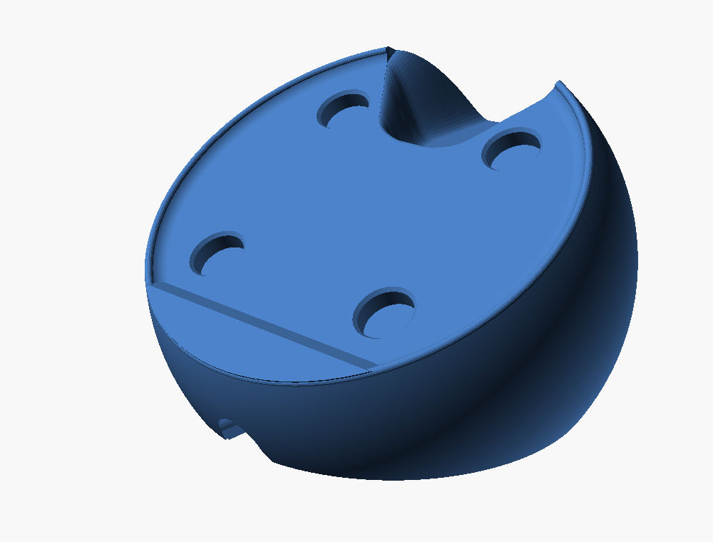
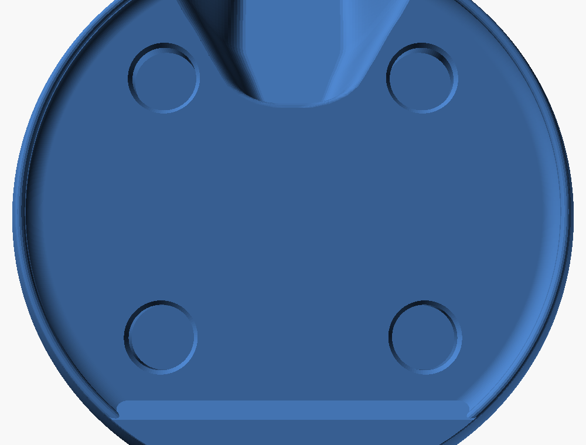
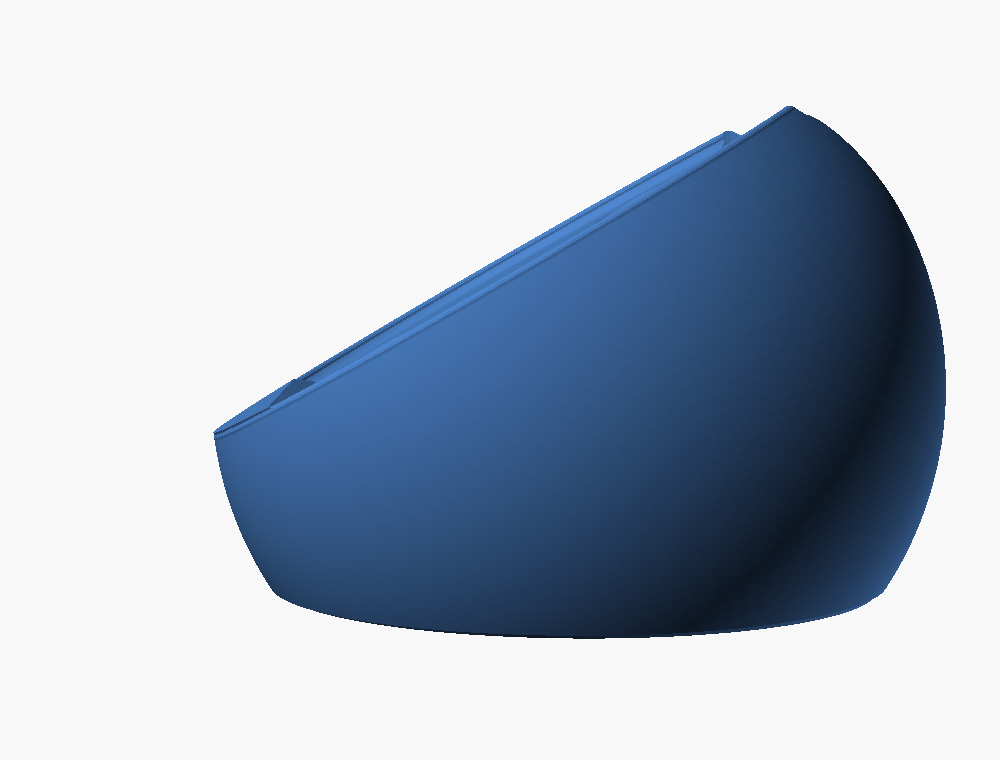
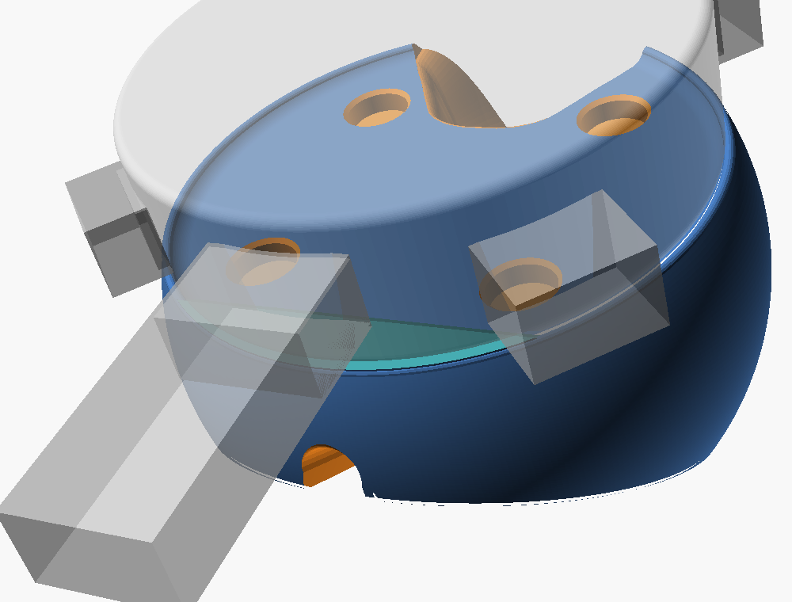
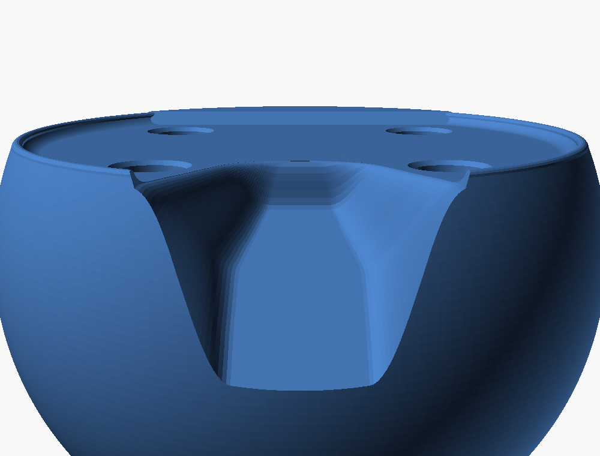
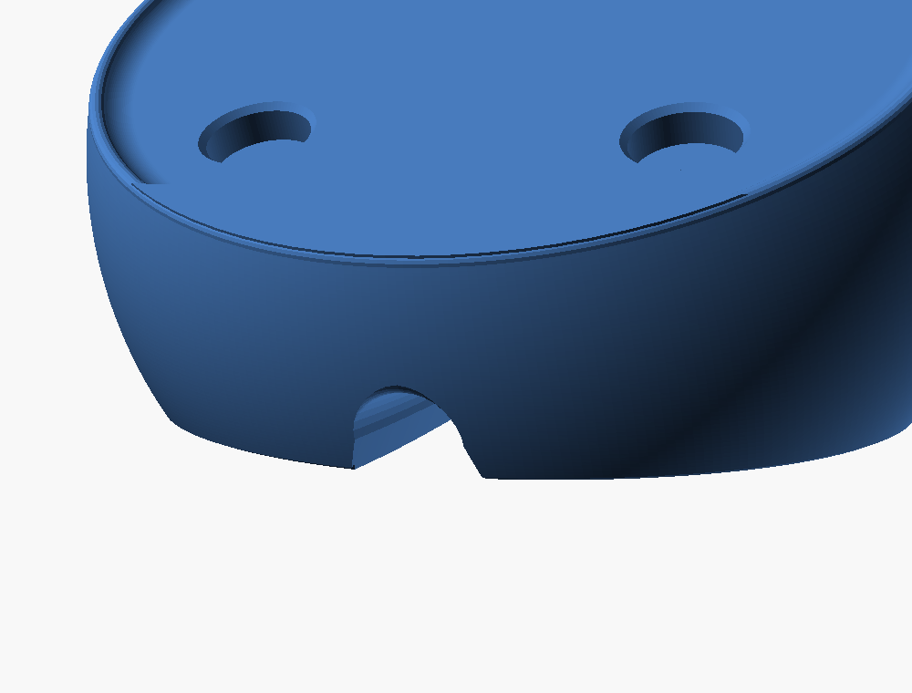
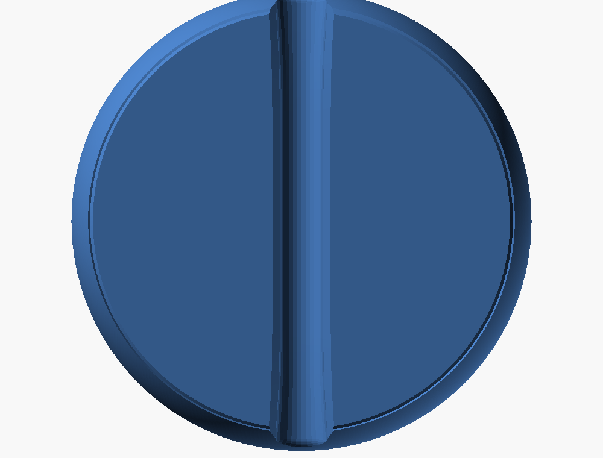
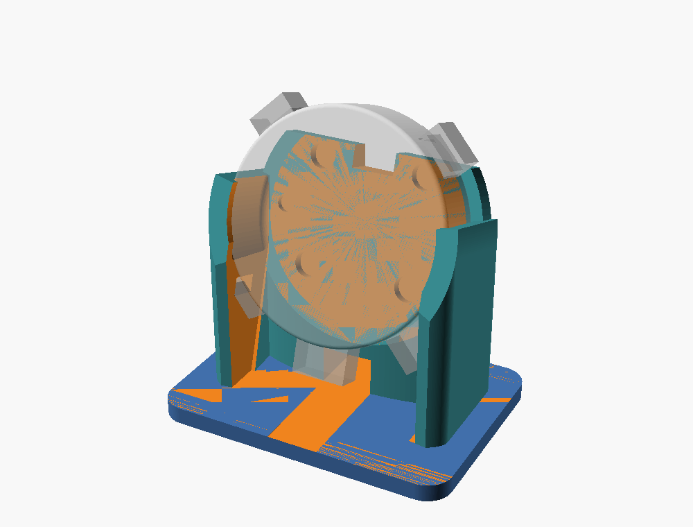

# M5Stack Stopwatch desk stands

There are two printable stands for the M5Stack Stopwatch (C152). Both hold it
lanyard-down, with both buttons, the power button, USB-C and Grove all
exposed, and both route the cable out behind. The device's geometry lives in
one shared file, [../lib/m5-stopwatch.scad](../lib/m5-stopwatch.scad). Each
`.scad` file has its settings at the top, and each `.stl` file is a
ready-to-print render of the defaults.

| | Puck dock | Upright cradle |
| --- | --- | --- |
| Source | [stopwatch-puck-dock.scad](stopwatch-puck-dock.scad) | [stopwatch-desk-cradle.scad](stopwatch-desk-cradle.scad) |
| Print file | [stopwatch-puck-dock.stl](stopwatch-puck-dock.stl) | [stopwatch-desk-cradle.stl](stopwatch-desk-cradle.stl) |
| Face angle | 30° from horizontal | 72° from horizontal |
| Size | 57 × 57 mm, 37 mm tall: a ball cut by the seat and the table | 70 × 50 mm, 58 mm tall |
| Holds the device by | A seat shaped to the device's back, a thin rim all the way round, and magnets | Cheeks at 3 and 9 o'clock, plus a back rest |
| Cable | An open, rounded channel under the foot | A tunnel under the back rest |

In the previews, the translucent shapes are the device and the space each
stand must leave clear: finger room at the buttons and power button, plug
room at USB-C and Grove, and an air gap behind the speaker.

## Where things are on the Stopwatch

These positions are for the device held lanyard-down, facing you.

| Feature | Position | Source |
| --- | --- | --- |
| BtnA (KEYA, G2) | 10:30, a 9 mm nub | Size drawing, photos |
| BtnB (KEYB, G1) | 1:30, a 9 mm nub | Size drawing, photos |
| Power button | 7:30, 5.7–11.6 mm from the back | Size drawing, the holster below |
| USB-C and lanyard hole | 6:00, 6.4–11.6 mm from the back | Size drawing |
| HY2.0-4P (Grove) | 4:30, 4.3–10.7 mm from the back | Size drawing |
| Speaker | Back: grille centred 15.7 mm above centre, dots within about ±3.3 mm and 12.6–18.7 mm up | Size drawing rear view |
| Magnets | Back, four on a square, 25.0 mm apart | The holster, then proven by the seat test; the drawing says 4 × Ø5 on 25.46 |
| Rear ø4 features | Back, at (±20, 0) | Size drawing; the holster clears them with Ø4.2 |
| Body | Ø51.95 at the face, about Ø51.35 at the back, 15.5 mm thick; R1 face edge, R2 back edge | Size drawing edge views; the holster only fits back-first |
| Speaker recess | Back, top: tongue-shaped, 2.4 mm deep, open at the top edge; tip 9.5 mm above centre, ±10.7 mm wide at 22 mm | Size drawing rear and edge views |
| Logo recess | Back, bottom: the M5 segment, 1.48 mm deep beyond 19.8 mm below centre, 45° ramp from 18.1 mm | Size drawing rear and edge views |

The sources are M5Stack's
[C152 size drawing](https://m5stack-doc.oss-cn-shenzhen.aliyuncs.com/1242/C152-StopWatch-model-size.pdf),
the [product photos](https://docs.m5stack.com/en/core/StopWatch), and
measurements of a working third-party holster, *CounterClock M5 Case v2*.
The drawing is printed rotated 180° from lanyard-down: its buttons appear at
4:30 and 7:30. It also uses first-angle projection. Read it wrongly and the
buttons end up at 3 and 9 o'clock, which an earlier revision of these stands
did.

## Puck dock









The dock is a ball, about 57 mm across, cut on top by the tilted seat and
flat underneath to sit on the table. It has no hard edges. The ball's centre
sits on the device's axis, 10 mm behind the seat, sized so the ball passes
exactly through the rim. Every profile runs along the ball's surface from
the table to the rim: one lofted surface, with no ledge, wall or cut. Where
the ball meets the table it curves in by about 25° from vertical, so it
prints without supports.

- **The seat follows the body.** The Stopwatch tapers: it's about 0.6 mm
  smaller across at the back than at the face, and its back edge has a 2 mm
  radius. The seat copies that shape with 0.2 mm clearance (proven), so the
  device settles into the centre.
- **One rim all the way round**, 1.2 mm high (`h_rim`). It covers just the
  back's rounded edge and rounds over about 1 mm thick against the device's
  side, so the dock ends at the device's silhouette. The buttons, power,
  USB-C and Grove all sit above it. This was the part of the first print
  the user liked best.
- **The seat matches the device's back** (from M5Stack's drawing; see the
  table above):
  - **Finger pocket (top):** a smooth trough that follows the outline of
    the device's speaker recess, 0.3 mm outside it (which keeps it clear of
    the top magnet pockets). Each side is one S-curve: it leaves the flat
    floor tangentially, rises up the wall, and eases out tangent to the seat
    about 1.2 mm past the outline, so there's no separate lip. The floor is level in the printed dock and snapped to the draft
    layer grid, so the full depth prints as one layer (z = 25.88 mm, layer
    boundary 107). It's 6 mm deep at the grille centre and eases in from
    nothing at the tongue's tip. It runs out through the top of the ball as
    a rounded channel. That's where a finger goes to pull the device out,
    and it keeps the speaker open to the air.
  - **Bottom step:** a raised step fills the device's recessed logo
    segment. It's 1.28 mm high (0.2 mm short of the recess), with the same
    45° ramp, set 0.3 mm outward. The device registers on it, and when you
    pull from the finger pocket the device pivots on it and comes out
    downward.
  - **Magnet pockets:** four Ø6.2 × 2.4 mm blind holes, with a small
    rounded lead-in. A 6 × 2 mm magnet pressed to the bottom sits 0.48 mm
    (two draft layers) below the seat: deliberately a little deep, rather
    than risk it standing proud. Magnets press-fit without glue (proven).
    Check each magnet's polarity against the device before pressing it in.
  - **No screw holes.** The device's rear ø4 features don't need them.
- **Cable:** a small, open, round-roofed channel, 5 mm wide, runs under the
  foot from front to back. Lay the cable in from below, so no plug has to
  fit through anything. It's a gentle hourglass from below. At each end it
  leaves the ball through a rounded arch with a 1.5 mm fillet
  (`channel_fillet`). The lips are rounded where they meet the desk. The
  rim's front sits 11.5 mm up, so a straight USB-C plug up to 28 mm long
  clears the desk (by 2 mm).
- **Printing:** print it on its foot without supports. The channel's round
  roof is a 5 mm bridge, the finger pocket's walls slope, and the ball meets
  the table at about 25° from vertical.

Earlier explorations are in git history: cheeks and a dipped front lip, a
front groove, a knife cut at the front (−78°), funnels, and buried magnets.

## Upright cradle



- **Cheeks** cup the rim from 12° above to 28° below horizontal, which lies
  between the buttons (35° above and higher) and Grove and power (35° below
  and lower). A 1.5 mm front lip on the cheeks keeps the device from sliding
  forward.
- **The back rest** reaches 16 mm above centre, so it covers all four magnet
  holes. It has the same speaker notch.
- **The bottom edge** is open from 4 to 8 o'clock. The device sits 14 mm
  above the base, and a 12 × 9 mm tunnel under the back rest carries the
  cable behind.
- **Printing:** print it on its base without supports. The only flat
  ceiling is the tunnel roof, a 12 mm bridge.

## Rendering and printing

Run these from the repository root:

```bash
openscad --backend=manifold --export-format binstl -o hardware/stopwatch-desk-cradle/stopwatch-puck-dock.stl hardware/stopwatch-desk-cradle/stopwatch-puck-dock.scad
```

```bash
openscad --backend=manifold --export-format binstl -o hardware/stopwatch-desk-cradle/stopwatch-desk-cradle.stl hardware/stopwatch-desk-cradle/stopwatch-desk-cradle.scad
```

To try buried magnets on the seat test (parked for now), add
`-D magnet_skin=0.48` to the command below. That's two 0.24 mm layers, and
it's only true layers here because the seat test prints flat. The magnets push in
from the bottom.

For a quick fit check of the puck dock, print just the top plate: the seat,
rim, bottom step, magnet pockets and finger pocket, lying flat. It's about
8.4 mm tall, with a 7.16 mm floor (0.2 + 29 × 0.24, on the draft layer grid)
so the finger pocket keeps its floor near the tip. The plate prints with the
seat flat, so the pocket floor, which is level in the dock, tilts 30° in
the plate and runs out through the top edge:

```bash
openscad --backend=manifold --export-format binstl -D seat_only=true -o hardware/stopwatch-desk-cradle/seat-test.stl hardware/stopwatch-desk-cradle/stopwatch-puck-dock.scad
```

- Open the STL in Bambu Studio and print it as modelled.
- Use PLA or PETG, 0.2 mm layers, 3 walls, and 15–20% infill.
- The fit is `fit = 0.2` mm per side, over the tapered body. The holster's
  straight Ø52.0 seat only goes on back-first, because the face end is the
  wide one. If the seat test binds, raise `fit` by 0.1. If it rattles, lower
  it by 0.05.

## Acceptance

Each layer is separate. Passing a CAD check says nothing about a physical
check.

**CAD** (see the `openscad-parts` skill)
- The file renders with the Manifold backend and no warnings.
- `mesh_check.py` reports one shell, 0 non-manifold edges and 0
  near-duplicate vertices.
- Intersecting the stand with `m5_body()`, `m5_keepouts()` and the button
  nubs renders empty.

*Recorded · September 29, 2026,* with OpenSCAD 2026.09.29 (snapshot):
- **Puck dock (simplified ball, full rim, matched seat):** 61,374 triangles, one shell, genus 0
  (the cable channel is open), 0 non-manifold edges, 0 inconsistently
  wound edges, 0 near-duplicate vertices, and no OpenSCAD warnings. The
  clearance test uses `m5_body_true()`, the body with its back recesses, so
  the bottom step is checked against the real recess. OpenSCAD's thrown-together view shows every face pointing
  outward. Intersecting the dock with the body, the keep-outs, the button
  nubs and a 28 mm straight USB-C plug was empty. That plug's lowest point
  sits 2.0 mm above the desk.
- **Upright cradle:** 7,170 triangles, genus 1 (the cable tunnel), 0
  non-manifold edges, 0 near-duplicate vertices. The keep-out intersection
  was empty.
- **Seat test print:** an 8.4 mm plate with a 7.16 mm floor (0.2 + 29 × 0.24), deep enough that the 6 mm finger pocket keeps a 1 mm floor. It has the rim, the step, the magnet pockets and the finger pocket. 29,092 triangles, genus 0, 0 non-manifold edges, 0 near-duplicate vertices.
History: the first seat test (`fit = 0.4`, a straight Ø52.75 pocket, 4 mm
lip) felt slightly large, because the lip only reached the narrow, rounded
back of the body. That led to the tapered pocket, the 0.2 mm fit and the
7 mm lip. The dock was then reshaped into the rounded version: no walls or
ledges, a varying-height rim, and an open cable channel.

These are CAD checks only. The physical results are below.

**Physical fit** (printed part plus a real Stopwatch)

*Recorded · September 29, 2026,* on a Bambu Lab A1 mini with a 0.4 mm
nozzle at 0.24 mm draft layers (the filament wasn't recorded). These prints
are of the windowed-lip version, before the rounded reshape:

- **Seat test** (`fit = 0.2`, tapered pocket, 7 mm lip): a perfect fit on
  the user's Stopwatch.
- **Magnets:** the holes (Ø6.2 at 25.0 mm pitch) line up, and 6 × 2 mm
  magnets press-fit without glue. Pressed flush with the seat, they left
  three layer lines of hole wall below them, which puts their thickness at
  about 1.92 mm. The pockets are now 2.4 mm deep, so a magnet sits 0.48 mm
  below the seat and can never lift the device.

*Recorded · September 30, 2026:* the user printed a full dock (the
knife-cut ball version). Their feedback shaped the current design:
- The low top rim was the best part, so it now runs all the way round.
- The front didn't need cutting, so it keeps the ball's natural shape.
- The seat should match the device's back: a deeper top pocket to pull the
  device out with a finger, and a step at the bottom that matches the
  device's own.
- The screw holes weren't needed.

The current design is untested. With only a 1.2 mm rim, the step, the
magnets and the tapered seat are what hold the device, so check that it
doesn't creep forward on the 30° seat. Re-run the seat test before trusting
`fit` on another printer, nozzle or layer height.

Checks for the full dock:

- A finger in the top pocket lifts the device out, pivoting on the bottom
  step.
- The device drops in and lifts out with one hand. It doesn't rattle when
  the desk is tapped.
- BtnA (left, 10:30) and BtnB (right, 1:30) click fully while docked, alone
  and as a two-button chord. Power presses, and USB-C charges with the cable
  in the channel.
- The speaker is no quieter docked than held in the hand.
- Tapping anywhere on the screen doesn't tip or slide the stand.

**Software note**
- The IMU axes this repo measured (IMU +x toward the lanyard) assume the
  device stands vertically. Docked, the device sits 60° off upright in the
  puck dock and 18° off upright in the cradle. Level, Pi Pet tilt and
  similar apps will show that offset until they are re-zeroed.
