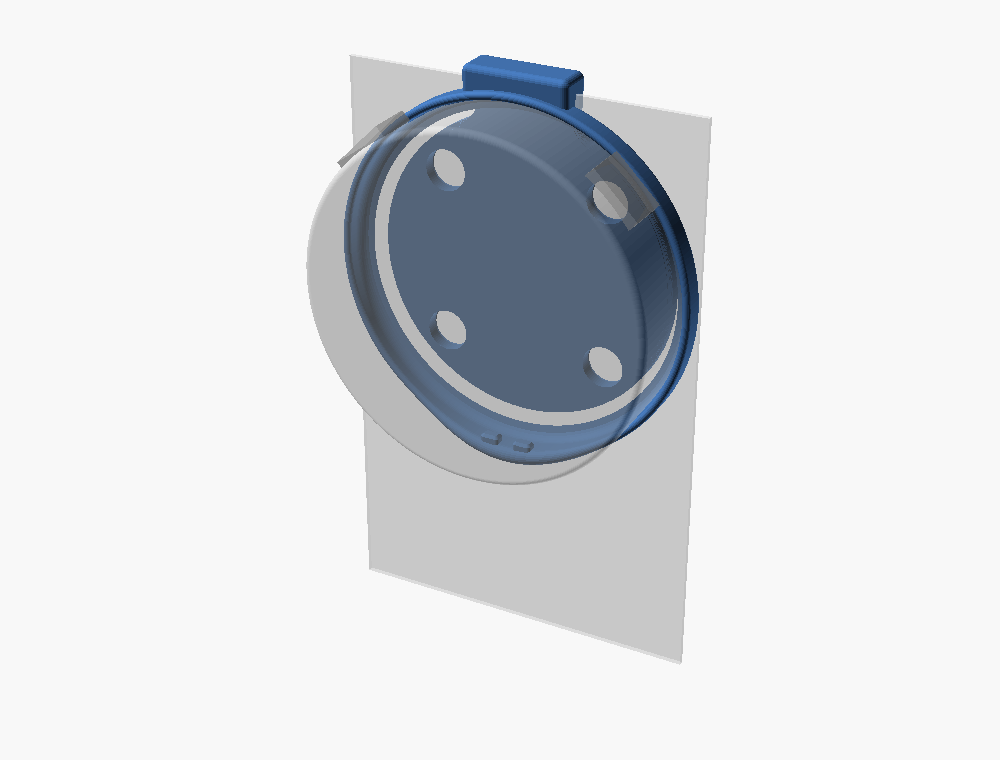
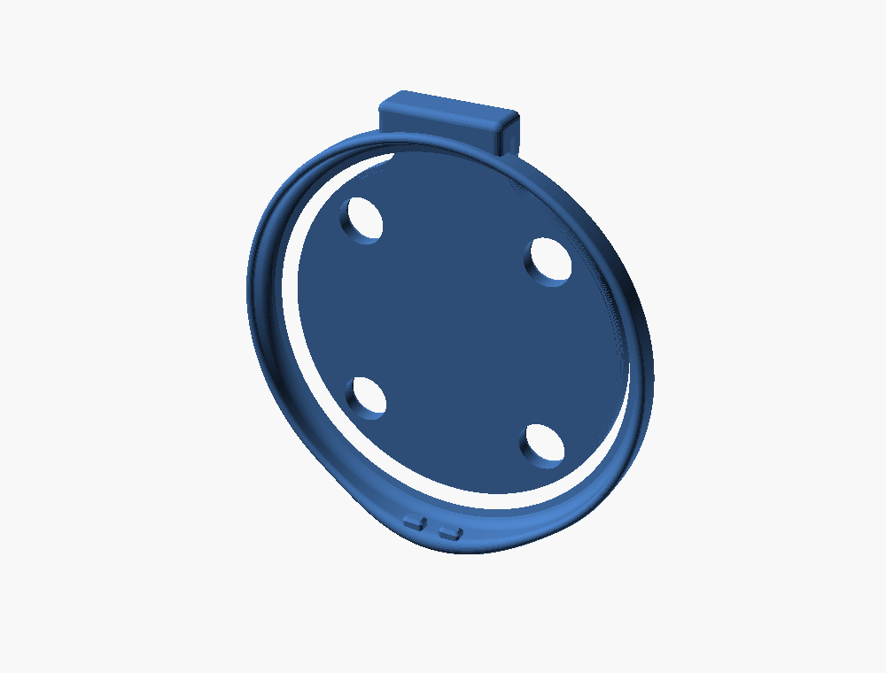
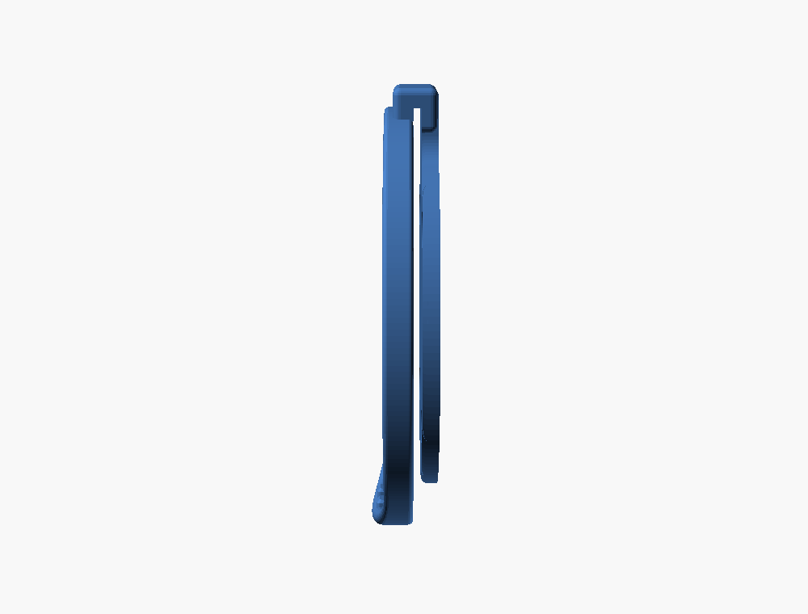
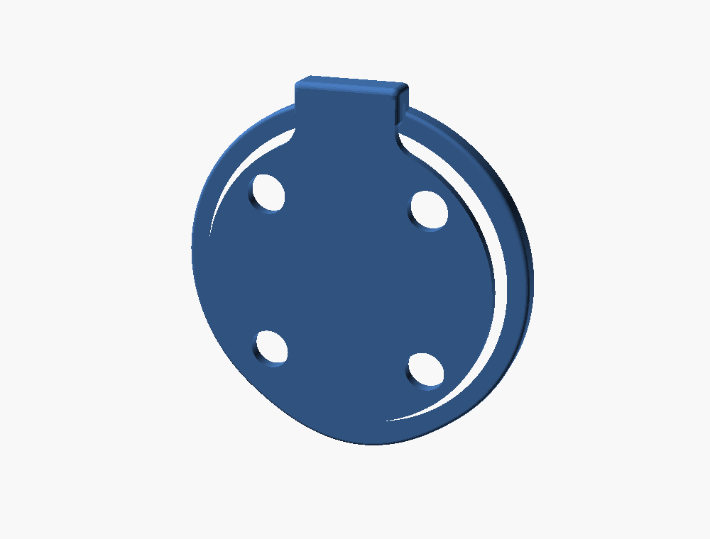

# Stopwatch lanyard clip

A clip that hangs on the top edge of a lanyard badge, at its centre between
the lanyard's two hooks, with the Stopwatch on the badge's front. It has
three parts, printed as one piece:

- **Ring:** a thin ring in front of the badge that wraps gently round the
  device's edge. It thickens toward 6 o'clock, where two small pegs drop into
  the device's lanyard holes and carry its weight. The USB-C port stays free.
- **U:** a U over the badge's top edge.
- **Backing:** sits behind the badge and holds four magnets. They pull on
  the device's own magnets through the badge, clamping the badge between the
  device and the backing.



| Device side | Side | Back |
| --- | --- | --- |
|  |  |  |

## Use

1. Put a dab of glue on the skin at the bottom of each magnet pocket on the
   backing's back. Press in the four 6 × 2 mm magnets, each oriented to
   attract the device's magnet opposite it.
2. Slide the clip down over the badge's top edge, between the hooks, so the
   badge sits in the slot between the ring and the backing.
3. Hold the Stopwatch, 12 o'clock up, with its top tilted toward you. Hook its
   two lanyard holes onto the pegs at the bottom of the ring.
4. Swing its top back into the ring. The magnets pull it onto the badge.
5. To take it off, tip the top forward and lift it off the pegs.

## Files

- `stopwatch-lanyard-clip.scad` is the parametric source. It uses the device
  geometry in [`../lib/m5-stopwatch.scad`](../lib/m5-stopwatch.scad).
- `stopwatch-lanyard-clip.stl` is the clip, exported flat, ready to slice.
- `peg-fit-test.stl` is just the ring's bottom and its pegs (28 × 9 ×
  5.5 mm). Print it first to check the pegs in the lanyard holes.

Render, from the repo root:

```bash
openscad --backend=manifold --export-format binstl -o hardware/stopwatch-lanyard-clip/stopwatch-lanyard-clip.stl hardware/stopwatch-lanyard-clip/stopwatch-lanyard-clip.scad
```

```bash
openscad --backend=manifold --export-format binstl -D 'part="peg_test"' -o hardware/stopwatch-lanyard-clip/peg-fit-test.stl hardware/stopwatch-lanyard-clip/stopwatch-lanyard-clip.scad
```

## Geometry

### The ring

The ring is a loft, one cross-section per degree and a half. Each section
follows the device's edge (its back fillet, then the tapered side) at a
0.2 mm fit, ends in a rounded bead, and has a rounded back outer edge. Its
back face is flush with the device's back, so both sit on the badge.

- **Round most of the edge:** it's 1.2 mm thick and reaches 3.1 mm forward
  from the back. With its bead, it ends 3.7 mm from the back, short of the
  buttons and Grove (from 4.3 mm) and power (from 5.7 mm).
- **Toward 6 o'clock:** it blends, over ±40°, to 2.4 mm thick and 4.3 mm
  forward. With its bead, it ends 5.5 mm from the back, short of the USB-C
  boss at 5.7 mm.

Its only job is location. The magnets hold the device in, and the pegs carry
its weight.

### The lanyard-hole pegs

M5Stack's drawing (the bottom edge view) shows the lanyard loop as two
rectangular holes in the bottom edge:

- **Size:** about 3.3 × 2.5 mm each.
- **Position:** centred 2.6 mm either side of 6 o'clock, 2.6–5.2 mm from the
  back.

The pegs are 2.9 × 1.8 mm with 0.5 mm corner radii. They reach 2.0 mm into
the holes and have chamfered tips. Their axial clearance (0.35 a side) lets
the device swing in on them like a hinge. Swinging the device in tips it
about 4–5°, which moves a 2 mm peg's tip about 0.16 mm, well inside that
clearance. The first print had 1.0 mm pegs. They lined up well, and they
were deepened to 2.0 for stability.

The holes' depth isn't on the drawing, so print `peg-fit-test.stl` first:

- **If the pegs don't go in:** shrink `peg_w` and `peg_h`, or shorten
  `peg_len`.
- **If the device won't swing in:** shorten `peg_len`.

### The backing and U

- **Backing:** a Ø45 disc with a neck up into the U, 2.44 mm thick. Its
  edges are rounded on the badge side.
- **Magnets:** 2.12 mm pockets at the proven 25.0 mm pitch and Ø6.2 press
  fit. They're open at the back, with a lead-in chamfer, and closed on the
  badge side by a 0.32 mm skin: two Optimal layers, a bridge and a solid
  layer over it, or one layer on Draft. The skin is a floor for a dab of
  glue.
- **Slot:** the badge's thickness plus 0.3 mm. The magnets pull the backing
  onto the badge's back.
- **U:** 16 mm wide and 2.5 mm thick over the badge's edge. It reaches 2.6 mm
  in front of the badge, and the device's outline (plus fit) is cut out of
  it.

The badge's top edge sits 27.3 mm above the device's centre, just above the
ring. The U rises 4 mm above the device's top.

## Parameters

| Parameter | Value | Notes |
| --- | --- | --- |
| `card_t`, `slot_gap` | 0.76, 0.3 | badge thickness (a CR80 card), and clearance through the U |
| `clip_w` | 16 | width of the U; it must fit between the lanyard's hooks |
| `wrap_side`, `wrap_bottom` | 3.1, 4.3 | how far the ring reaches forward from the back, before its rounded rim |
| `ring_side`, `ring_bottom` | 1.2, 2.4 | the ring's thickness |
| `bump_span` | 40 | the thicker bottom blends out over ±40° |
| `peg_x`, `peg_from_back` | 2.6, 3.9 | the lanyard holes' centres |
| `peg_w`, `peg_h`, `peg_len` | 2.9, 1.8, 2.0 | peg size, and how far each enters its hole |
| `backing_r`, `backing_t` | 22.5, 2.44 | the backing: the 2.12 pockets plus the skin, 0.2 + 14 × 0.16 |
| `magnet_skin` | 0.32 | over each magnet on the badge side: two Optimal layers; Draft prints it as one 0.24 layer |
| `magnet_pitch`, `magnet_hole_d` | 25, 6.2 | proven by the dock's seat test |

## Printing

Print it as exported, flat on the backing's back, with supports on the build
plate only. Use the A1 mini's 0.4 mm Optimal profile (0.16 mm layers) for the
real part, and Draft (0.24 mm) for tests. Both have a 0.2 mm first layer.

- **Backing:** prints flat, with its magnet pockets as true circles. Each
  pocket's skin is the backing's top layer, bridged across 6.2 mm.
- **Ring:** sits 3.2 mm above the bed, over the slot and the backing, and
  mostly outside the backing. Supports carry it. Over the backing's neck, at
  12 o'clock, it joins the U and bridges the slot.
- **Ring's back face:** this is the face that touches the badge. It prints on
  supports, so it'll be a little rough.
- **Peg fit test:** prints on the ring's back face with no supports.

## CAD evidence (2026-10-02)

- `mesh_check.py`, clip: one shell, genus 1 (the ring), 25,634 triangles,
  54.2 × 58.1 × 9.0 mm as printed. As printed, the magnet pockets run from
  the bed to 2.12 mm, under a skin from 2.12 to 2.44 mm. No
  non-manifold edges, inconsistent windings or near-duplicate vertices.
- The ring alone (the lofted polyhedron) is clean, genus 1.
- **Ring, U and backing against the device:**
  - With `m5_body_true()`: zero volume. The ring's back edge only touches the
    device's back.
  - The pegs reach 2.0 mm into the device's outline, at the lanyard holes,
    by design.
- **Ring, pegs and U against `m5_keepouts()`:** zero volume, so they're clear
  of the buttons, power, USB-C and Grove.
  - The backing sits behind the speaker's air gap. It's behind the badge,
    which covers the speaker anyway.
- `mesh_check.py`, peg fit test: one shell, genus 0, 4,314 triangles.

## Open questions

- **Hooks:** the device covers the badge out to x = ±18 mm, 5 mm below the
  badge's top edge. The lanyard's hooks need to sit outside that.
- **Magnets:** they now pull through the skin and the badge, about 1.4 mm
  more gap than on the dock. They only need to hold the device against the badge, but check
  that it snaps in firmly.

## Physical evidence

- 2026-10-02: the user printed the 1.0 mm pegs, and they lined up well with
  the lanyard holes. The pegs were then deepened to 2.0 mm.
