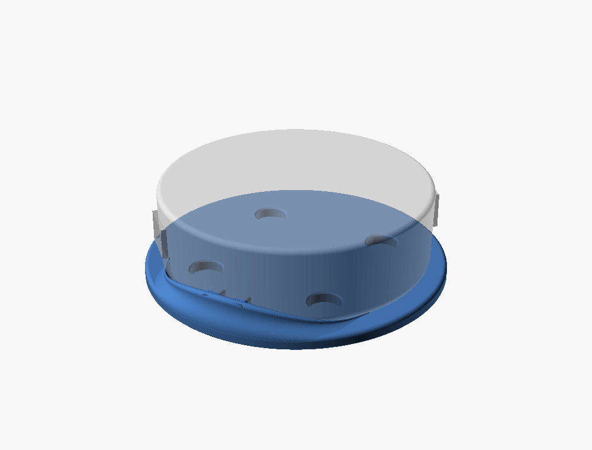
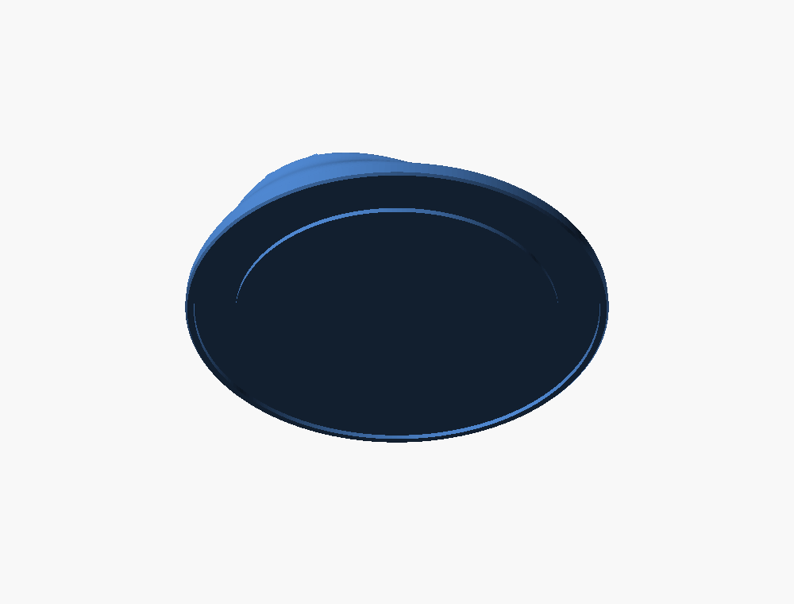
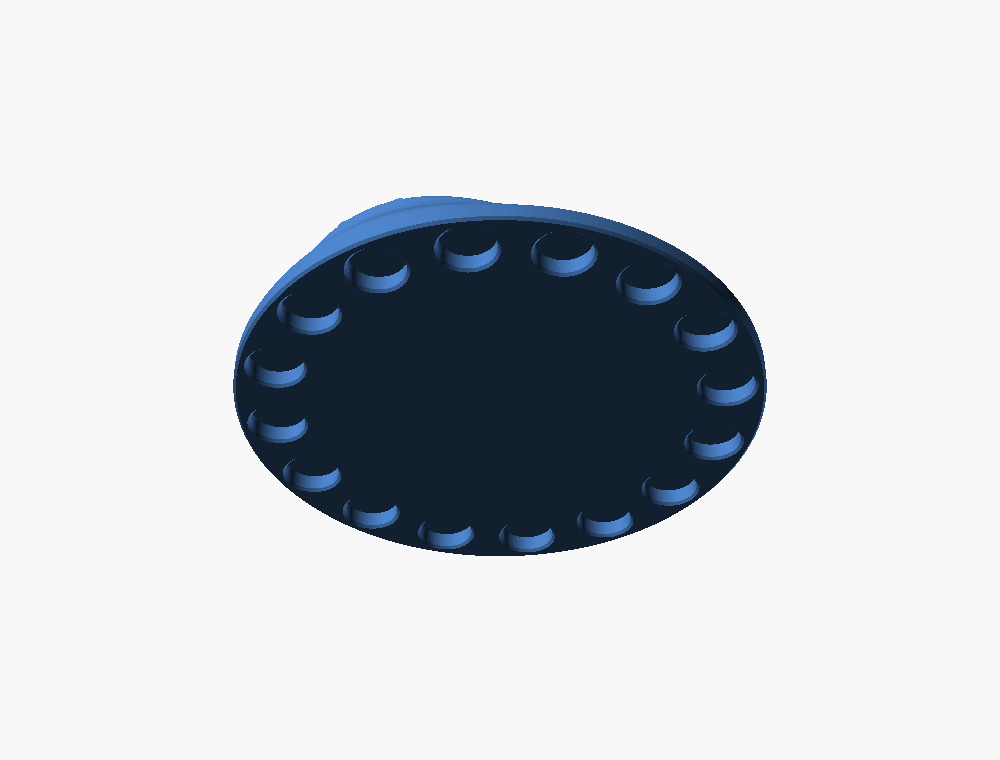
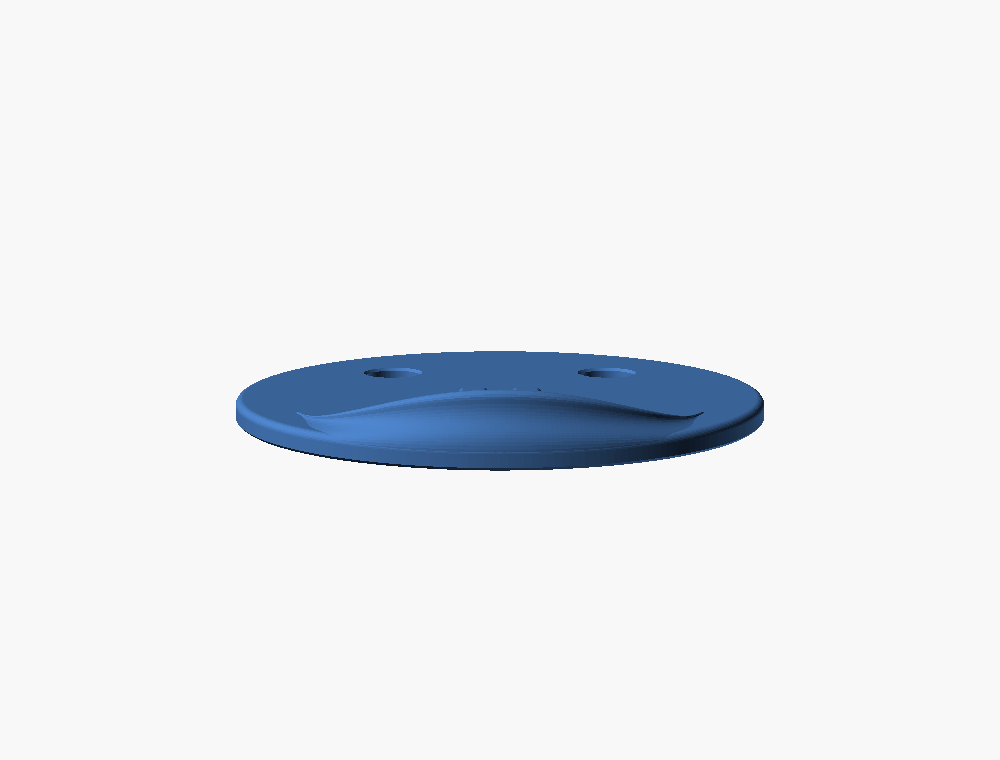

# Stopwatch MagSafe adapter

A thin disc that puts the Stopwatch on the back of a MagSafe iPhone. It's
2.44 mm thick.

- **Device side:** four 6 × 2 mm magnets on the Stopwatch's 25 mm square
  grab the device's own back magnets, using the dock's proven pitch and
  press fit. A short lip at 6 o'clock carries the lanyard clip's grip: two
  2 mm pegs that reach into the device's lanyard holes and carry its
  weight. Hook the device's bottom onto the pegs, then swing its top down
  onto the magnets.
- **Phone side:** something for the phone's MagSafe ring to grab. It sits at
  the ring's radius, about 23–27.5 mm, outside the device magnets, which
  reach 20.8 mm.

The two sets sit at different radii, so their pockets never stack. The disc
is only as thick as one magnet plus a two-layer skin.

| Device side, with the lip | Phone side (steel ring recess) | Phone side (magnet ring) |
| --- | --- | --- |
|  |  |  |

## The lanyard-hole lip

This is the bottom of the lanyard clip's ring, made into a lip that grows
out of the plate. It's a loft of cross-sections over ±60° of 6 o'clock.

- **Inside:** each section follows the device's edge (back fillet, then
  tapered side) at a 0.2 mm fit. At 6 o'clock it reaches 4.3 mm up the
  edge, plus a 0.8 mm rounded rim, so it ends 5.1 mm from the back, short of
  the USB-C boss (5.7).
- **Outside:** from the rim it sweeps down and out in an S-curve (a cubic
  Bézier, vertical at both ends) to the disc's own edge, just below its
  round-over. The plate's rim seems to rise into the lip.
- **Ends:** its height fades smoothly (cos²) to nothing at ±60°. There the
  S-curve dips inside the disc and the lip merges into it. At power (7:30)
  and Grove (4:30) it's under 2.1 mm high, below their 3.8 mm finger margin.
- **Pegs:** the lanyard clip's, unchanged: 2.9 × 1.8 mm with 0.5 mm corner
  radii, centred 2.6 mm either side of 6 o'clock and 3.9 mm from the
  device's back. They reach 2.0 mm into the holes and have chamfered tips.
  Their 0.35 mm axial clearance lets the device swing in on them.
- **Peg roots:** they reach only 0.6 mm back into the lip, past its inner
  face (`peg_root`). Their roots are flat, so at their outer corners a
  deeper root showed through the lip's curved outside.

## Two ways to grip the phone

### `grip = "steel_ring"` (default, recommended): `stopwatch-magsafe-adapter.stl`

A stick-on steel MagSafe ring sits in a 0.68 mm recess on the phone side.
KraftGeek lists it at 55 mm OD × 45 mm ID × 0.55 mm. The first print's
recess, sized from that listing, was 1 mm too small across both edges, so
the recess is now 43.4–56.6 mm. Steel is pulled by any magnet pattern, so
MagSafe's polarity doesn't matter. Apple doesn't publish that polarity, and I
couldn't find a reliable breakdown of it.

- **Size:** Ø59 mm, about 3.5 mm wider than the Stopwatch all round.
- **Part:** [KraftGeek universal metal ring sticker](https://kraftgeek.com/collections/bfcm-rec/products/universal-metal-ring-sticker)
  (55/45/0.55 mm, 2.5 g). Any 0.5 mm "metal ring for MagSafe" of about that
  size fits. Set `ring_od`, `ring_id` and `ring_t` to match.
- **Fit:** the recess allows 0.3 mm round the ring, and the ring sits
  0.13 mm below flush.
- **Rotation:** steel doesn't self-align, so the adapter can turn on the
  phone, held only by friction. The device can't turn on the adapter: its
  four magnets lock it.

### `grip = "magnets"`: `stopwatch-magsafe-adapter-magnets.stl`

Sixteen more 6 × 2 mm magnets sit in a ring at r = 25.3, all with the same
face toward the phone. Nothing extra to buy.

- **Size:** Ø59.2 mm.
- **Test first:** hold one magnet flat on the back of the phone and slide it
  round the MagSafe ring. If the same face attracts all the way round, this
  variant works with that face out. If it pulls at some angles and pushes at
  others, use the steel ring.
- **Pockets:** these are 2.08 mm deep and open on the phone side, with a
  0.36 mm skin toward the device, so the magnet faces touch the phone. Add a thin film or felt
  there if you don't want bare metal on the glass.

## Assembly

1. Put a dab of glue in each device-side pocket. They open upward, on the
   side with the lip, over a 0.36 mm skin. Press in the four magnets, each
   oriented to attract the Stopwatch's magnet opposite it. Let the device
   do the orienting: seat each magnet on it, then press it into the pocket.
2. Then fit the phone grip:
   - **Steel ring:** peel it and stick it into the recess on the flat phone
     side, adhesive down.
   - **Magnet ring:** glue the sixteen magnets in with the tested face out.
3. Snap the adapter onto the phone's MagSafe with the lip at the bottom.
   Hook the Stopwatch's lanyard holes onto the pegs, 12 o'clock up, and
   swing its top down onto the magnets. To remove it, tip the top away and
   lift it off the pegs.

## Printing

Print it as exported, phone side down, without supports or a brim, on
Optimal (0.16 mm layers). The phone side prints on the bed, so it comes out
flat and smooth against the phone.

- **Device pockets:** open upward, so there's nothing to bridge. Their floor
  is at 0.36 mm (the first layer plus one Optimal layer) and the top at
  2.44, so they're 2.08 mm deep. On Draft they print about 1.92 deep, the
  magnets' measured thickness.
- **Steel ring's recess:** it's in the bed face, so its 0.68 mm ceiling
  (a line both profiles share) bridges the 5.6 mm-wide annulus. That's the
  only bridge.
- **Pegs:** they reach 2 mm inward from the lip, a short overhang at 3.9 mm
  above the disc.
- **Lip:** its inside rises along the device's edge, leaning out no more
  than the device's own taper and back fillet. Its outside sweeps in as it
  rises, so it overhangs nothing.

Both disc edges are softened: a 0.8 mm round-over on the device side, and a
0.3 mm chamfer on the bed side against elephant's foot.

## Parameters

| Parameter | Value | Notes |
| --- | --- | --- |
| `grip` | "steel_ring" | or "magnets" |
| `disc_t`, `pocket_floor` | 2.44, 0.36 | device pockets 2.08 deep |
| `magnet_pitch`, `magnet_hole_d` | 25, 6.2 | proven by the dock's seat test |
| `ring_od`, `ring_id`, `ring_t` | 56, 44, 0.55 | the steel ring: the listing's 55 × 45, plus and minus 1 mm after the first print |
| `ring_clear`, `ring_recess` | 0.3, 0.68 | |
| `phone_r`, `phone_n`, `phone_depth` | 25.3, 16, 2.08 | the magnet ring: MagSafe's mid-radius, 9.9 mm apart |
| `lip_span`, `lip_wrap`, `lip_bead` | 60, 4.3, 0.8 | the lanyard-hole lip |
| `peg_x`, `peg_from_back`, `peg_w`, `peg_h`, `peg_len` | 2.6, 3.9, 2.9, 1.8, 2.0 | the lanyard clip's pegs |
| `peg_root` | 0.6 | how far the pegs reach back into the lip |
| `rim` | 1.2 | wall outside the grip |

## Sources

- MagSafe ring sizes: ring magnets for cases are usually about 54–56 mm OD
  and 46 mm ID
  ([Medium](https://medium.com/@duanh148/what-size-is-magsafe-magnet-7b14f5d6c450),
  [Total Element](https://totalelement.com/products/56-x-46-x-1-5mm-magsafe-neodymium-rare-earth-magnet-phone-attachment-ring-assembly-4-pack)).
- On polarity, MakerWorld's DIY MagSafe rings say only to "pay attention
  to the direction" ([example](https://makerworld.com/models/2121665)).
  Apple doesn't publish it, and a vendor's claim that it's a Halbach array
  ([HSMAG](https://www.hsmagnets.com/blog/what-magsafe-magnet-on-the-iphone-12-is/))
  is unconfirmed.

## CAD evidence (2026-10-19)

- `mesh_check.py`:
  - **Steel ring:** one shell, genus 0, 19,612 triangles, 59.0 × 59.0 ×
    7.5 mm (2.44 at the disc, 7.5 at the lip's rim).
  - **Magnets:** one shell, genus 0, 26,904 triangles, 59.2 × 59.2 ×
    7.5 mm, with 2 near-duplicate vertices.

  No non-manifold edges or inconsistent windings. The lip alone (the lofted
  polyhedron) is clean.
- **With the device posed on the disc:**
  - The disc and lip intersected with `m5_body_true()`: zero volume. The
    lip's tails only touch the device's back fillet.
  - The lip and pegs intersected with `m5_keepouts()`: empty, so they're
    clear of the buttons, power, USB-C and Grove.
  - The pegs reach 2.0 mm into the device's outline, at the lanyard holes,
    by design.
  - The pegs, less the lip and the device: only the 0.2 mm fit gap between
    them (2 mm³, at radius 25.7–26.3). Nothing reaches the lip's outside,
    which is beyond 27.3 at that height.

## Physical evidence

- 2026-10-19: the KraftGeek steel ring arrived.
- 2026-10-21: the first print's recess (44.4–55.6 mm, from the listing plus
  0.3 mm a side) was too small for the ring. It's now 1 mm smaller inside
  and 1 mm bigger outside, 43.4–56.6 mm, and the disc is Ø59.
- The lanyard-hole pegs are the lanyard clip's. Its 1.0 mm peg test lined up
  well with the device (2026-10-02).
