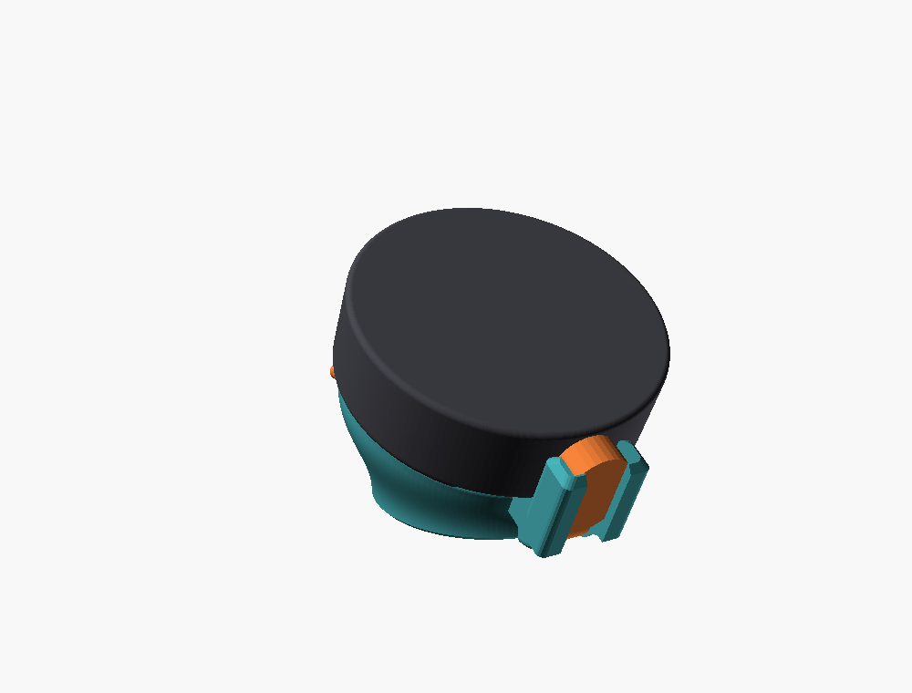
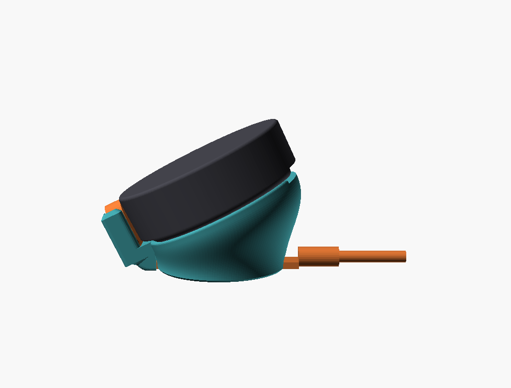
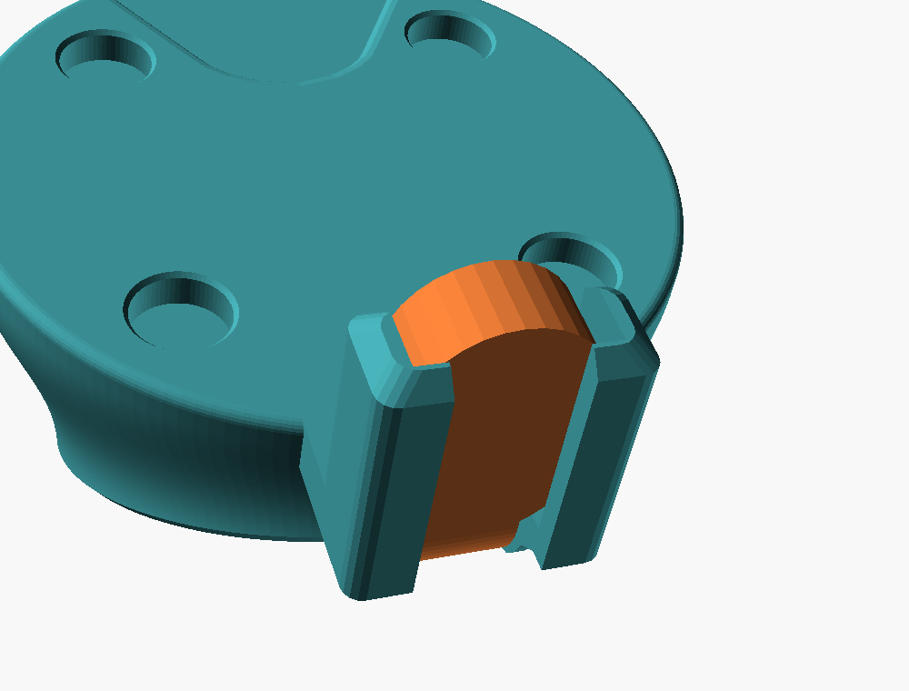
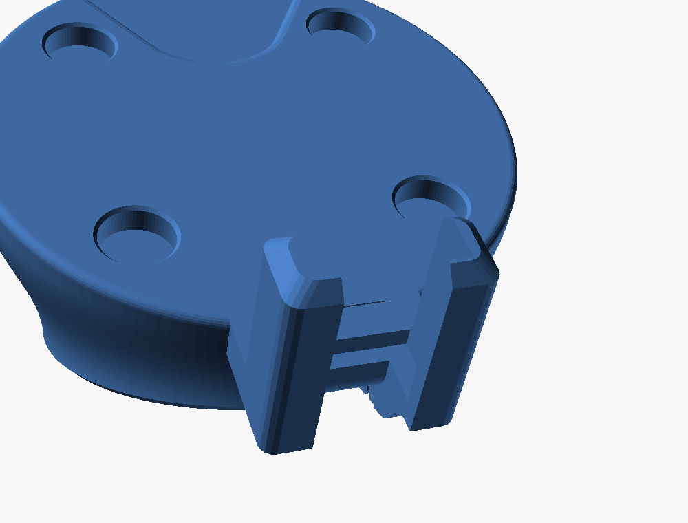
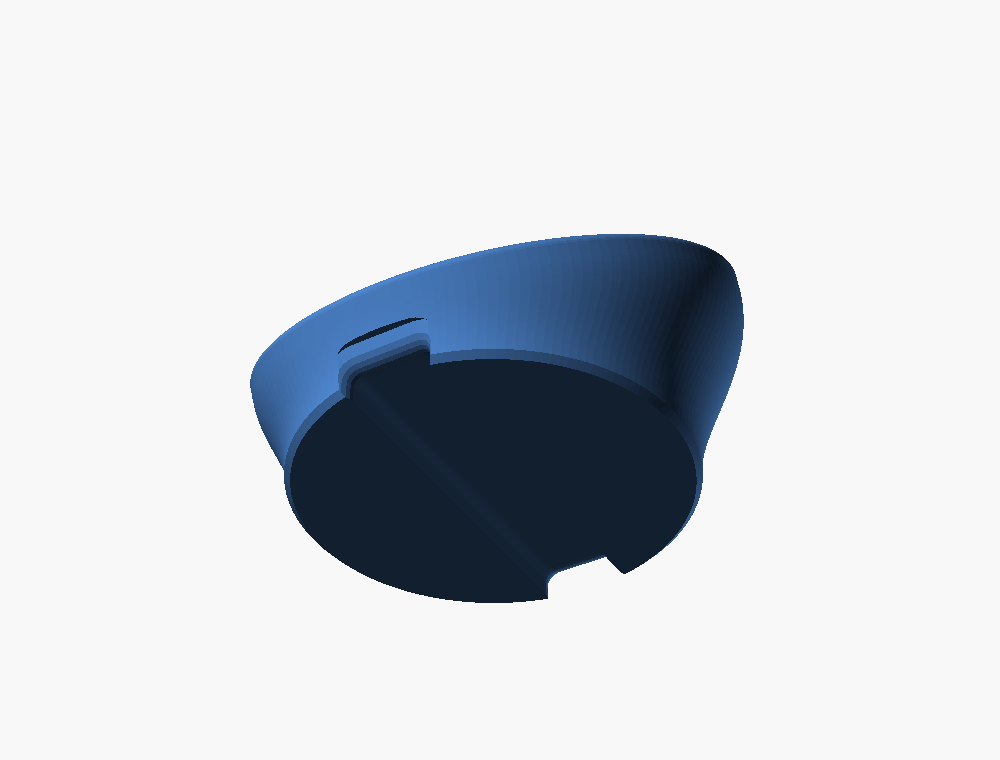
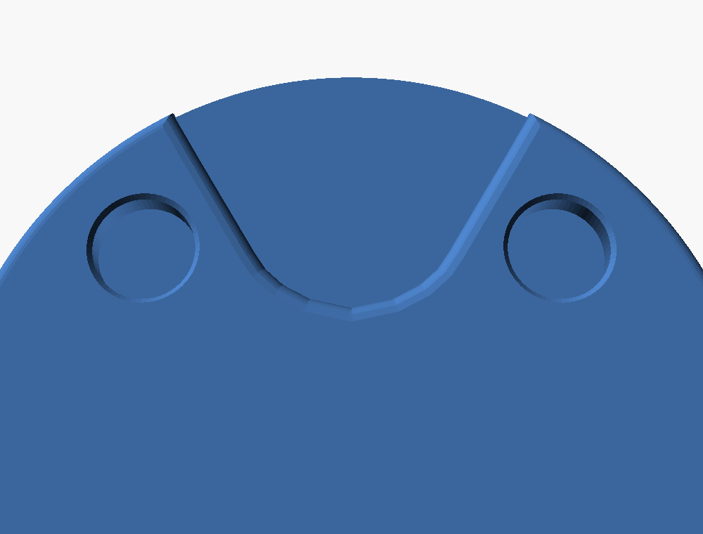
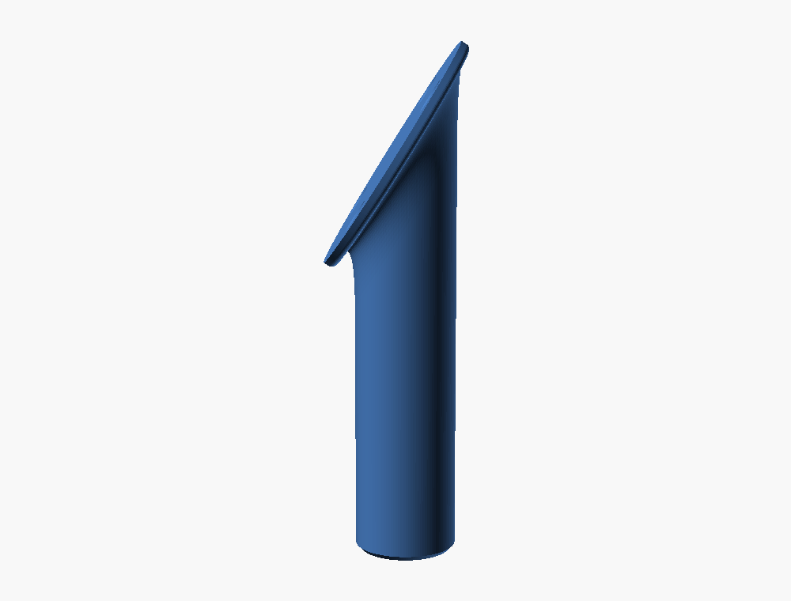
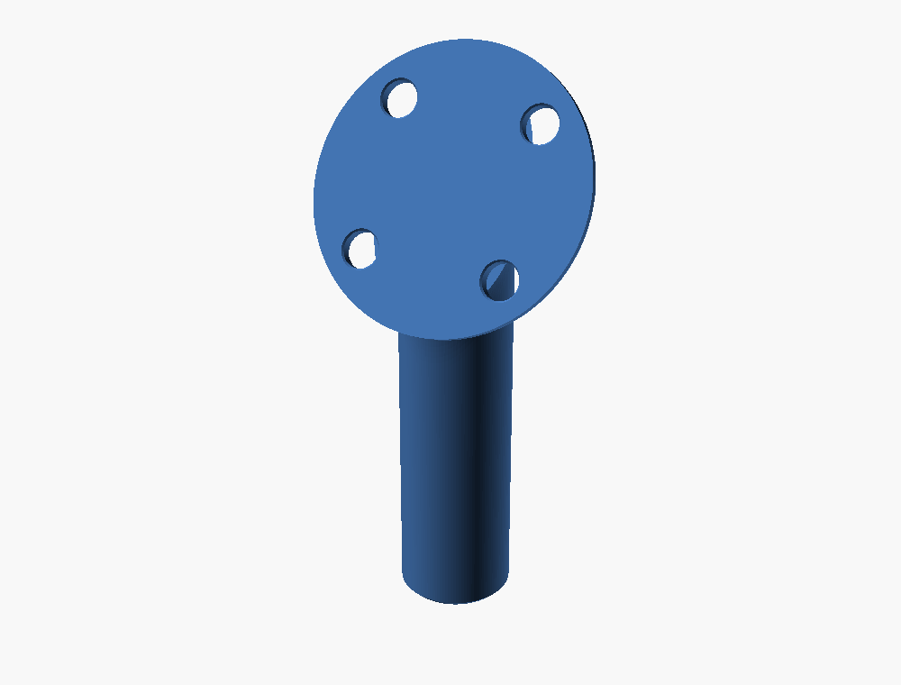
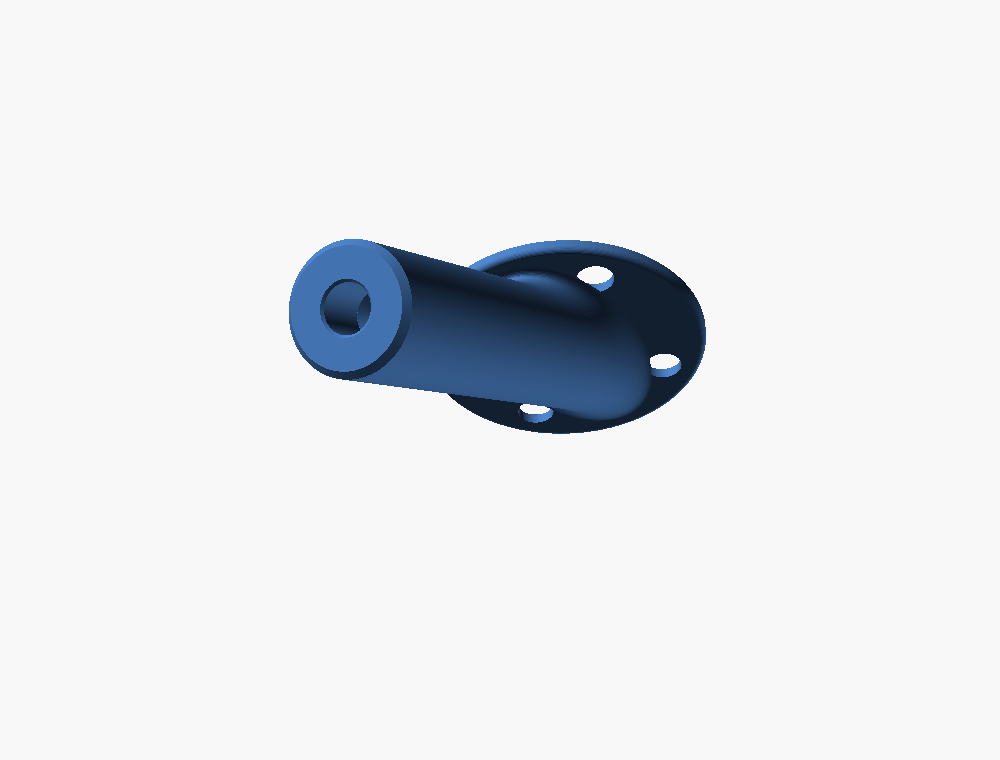

# Stopwatch stem mounts

Two parts that share one idea: a flat top held to the Stopwatch by its four
back magnets, on a stem that blooms into the top like a vortex.

- **Desk stand** (`stopwatch-desk-stand.scad`): a low, thick stem after
  the Harness reference, with the device sitting on top. The top leans
  back 26°. A nose at the front holds a right-angle USB-C cable's head,
  after the notch in the Harness, and the cable runs under the stand
  through a filleted channel. The stand is as low as that cable allows.
- **Tripod mount** (`stopwatch-tripod-mount.scad`): a thin plate on a 3"
  stem at 32°, with a 1/4-20 insert in its end.

## Desk stand



| Side | The notch, holding the head | The notch, empty | Underside |
| --- | --- | --- | --- |
|  |  |  |  |

This is the Harness reference stand's form, with the Stopwatch sitting on
top instead of built in. A short, thick stem (Ø38 where it stands on the
desk, with a 0.6 mm chamfer) opens in one vortex bloom into a flat Ø48 top,
inset about 1.7 mm from the device's back edge. The top leans back 26° from
horizontal, the Harness's angle (25.8°, measured from its face's normal).

Each line up the stand is one profile, built at the top's angle round the
rim: the base chamfer, then a cubic bloom from the stem, where it's
vertical, out to the rim. The bloom ends parallel to the top's normal, so
it flows into a 2 mm rim band and a 0.8 mm round-over onto the top. It's
solid and never leans more than 45° from vertical.

### The cable, and the height it sets

The stand is built round a right-angle cable: [MEOU USB-C, 90°, flat
ribbon](https://www.amazon.com/dp/B0DQ8B8PFR). Its head is a flat pill,
5 mm thick, with the plug in its rounded end. The flat ribbon leaves the
other end in line with the head, so the plug stands up 90° from the ribbon.
On the 6 o'clock port, the head sits against the device's edge, and the
ribbon runs straight back along the device's thickness, with no twist. It
drops down past the stand's front, bends onto the desk and runs back
under the stand. The flat run ends in a collar where it joins the braided
cable.

The height comes from that path (`cable_face_z()`):
- the plug's centre is at the port's mid-height (9 mm from the back);
- the head runs `usb_head_len - usb_plug_from_end` past it;
- the ribbon goes `ribbon_stiff` straight, then bends (inner radius
  `ribbon_bend_r`) until it lies flat on the desk.

With the estimates below, the top's centre is 18.9 mm up and the device's
front edge is 9.0 mm off the desk (it was 12.7). `face_lift` adds height if
the real cable needs more room.

The listing gives only the head's 5 mm thickness. Every other value is
estimated from its photos, so measure the cable and correct them:

| Parameter | Estimate | What it is |
| --- | --- | --- |
| `usb_head_w` | 11 | head width, along the port's wide axis |
| `usb_head_len` | 16 | head length, from its rounded end to where the ribbon leaves |
| `usb_plug_from_end` | 5.5 | from that rounded end to the plug's centre |
| `ribbon_w` × `ribbon_t` | 7 × 2 | the flat ribbon |
| `ribbon_stiff` | 2 | stiff run out of the head before it bends |
| `ribbon_bend_r` | 3 | its tightest comfortable inner bend |
| `flat_len` | 50 | ribbon length from the head to the collar (preview only) |
| `collar_len` × `collar_d` | 12 × Ø6 | the joint between flat and braided |
| `braid_d` | 3.5 | the braided cable |

### The channel

The channel runs straight from front to back under the base, along the
stand's plane of symmetry. It's the ribbon's section plus
`channel_clear` (0.5 mm) each side and above: 8 × 2.5 mm, open to the desk.
Its top edges are rounded (`channel_round`, 1 mm). At the back, where it
opens through the stand's wall, it flares with a 2 mm quarter-round fillet
(`channel_fillet`) on the roof and both sides. At the front, it continues
straight from the nose's groove (below). With `notch = false`, the front
gets the same fillet, and the ribbon's bend hangs in the air 1.5 mm in
front of the base.

### The notch

This idea comes from the Harness stands in [Dee's
video](https://x.com/dee_hw/status/2110394211556348280): a small notch in
each stand's front, under the puck, holds the cable's end. Here, a nose at
6 o'clock holds the right-angle head exactly where it sits when plugged in:
- **Pocket**: the head's outline plus `notch_clear` (0.15 mm, snug, because
  the walls hold it). It's open toward the device, so the plug reaches the
  port, and open at the top, so the head drops in.
- **Side walls** (`notch_wall`, 2 mm) locate the head across.
- **Ledge**: the pocket narrows from the head's width to the ribbon's
  under the head's foot, and carries the head.
- **Front lips** (`notch_lip`, 1.5 mm) cover the head's outer face at each
  side. They take the plug's push when docking. Between them, a window as
  wide as the ribbon groove shows the head, like the light part in the
  Harness's notch.
- **Hook**: below the top, the nose runs back into the stand behind the
  head's foot, so a pull toward the device has something to bear on.
- **Groove**: the ribbon drops from the head through a groove that's open
  at the front, so you press the ribbon in. It runs round the bend into the
  channel under the base, which no longer needs a front fillet.
- The nose's top is `notch_top` (13 mm) above the stand's top. The device's
  face is at 15.5 and the head's top at 14.5.

To use it, leave the head in the notch. Slide the device down the top onto
the plug, and the magnets settle it in place. To take the device off, slide
it up the top to unplug, then lift. The head stays parked. The nose sits
outside the device's edge, so it never touches the device.

Because the head's size is still an estimate, `notch_test = true` exports
just the nose and the stand's front
(`stopwatch-desk-stand-notch-test.stl`, 25 × 17 × 19 mm, about 1 cm³), to
check the fit before printing the whole stand. Tune `notch_clear` and the
head's dimensions from it.

### The collar

The flat run is long enough that the collar, where it joins the braided
cable, lands behind the stand. So the channel makes no allowance for it,
and its back mouth just has the same 2 mm fillet. With the estimated
50 mm run, the collar starts about 4 mm behind the base. `flat_len` only
places it in the preview.

Details:
- Magnet pockets: Ø6.2, 2.4 deep (blind), at 25 mm pitch, with a 0.3 lead-in:
  the dock's proven press fit.
- Speaker relief: a 1.5 mm pocket under the device's speaker recess, out
  through the rim at 12 o'clock (`speaker_relief = 0` for a flat top). Its
  top edge has a 1 mm quarter-round round-over (`speaker_round`). It's made
  from slices of the outline, each grown by the round's offset at its
  depth and hulled in pairs, which is exact because the outline is convex.
  
- The 1/4-20 insert hole in the bottom is now off by default
  (`insert = false`), because the channel runs across its spot.
- `show_cable = true` adds the cable, as estimated, to a preview.

Render, from the repo root:

```bash
openscad --backend=manifold --export-format binstl -o hardware/stopwatch-mount/stopwatch-desk-stand.stl hardware/stopwatch-mount/stopwatch-desk-stand.scad
```

Print it as it stands, on its base, without supports or a brim. The
channel's roof is an 8–9 mm bridge, and nothing else is steeper than 45°.

### Desk stand CAD evidence (2026-10-03)

- `mesh_check.py`: one shell, genus 0 (the channel and groove are open),
  21,950 triangles, 26.9 cm³. No non-manifold edges or inconsistent
  windings, and 12 near-duplicate vertices where the nose's hulls meet.
  The steep downward faces are the channel's bridged roof (225 mm² flat)
  and about 130 mm² at 50–90° in the groove's bend and the notch.
- Size: 48.0 × 58.2 × 28.0 mm, with the nose. The notch test piece is
  25.4 × 16.5 × 18.6 mm, one clean shell.
- With the device posed on the top, `m5_body_true()` intersects the stand
  empty, and so do the keep-outs for the buttons, PWR, Grove and the
  speaker. The USB-C keep-out is replaced by the cable model, because the
  head now fills that space by design. The device's lowest point is
  z = 9.0.
- The cable model (the head, the ribbon down, round the bend and through the
  channel, the collar behind it and the braid) intersects the stand empty. It touches the
  device only where the head stops against its edge.

History: a 61 mm wine glass with a flared foot and a waist, then the same
form lowered to 1/2", where the foot became a coaster. Then a thick stem at
1/2". Now it's lowered to the cable's limit.

# Tripod mount

A thin, flat plate that sits behind the Stopwatch, inside the edge of its
back, on a 3" stem of 3/4" (19.05 mm) tube. The stem leaves the plate's
back at 32° and ends in a hole for a 1/4-20 heat-set insert. The device is
held by its four back magnets alone. Screw the mount onto a tripod, light
stand, ball head or magic arm: with the stem vertical, the Stopwatch's face
stands 58° from horizontal, looking toward you and a little up, lanyard
down. The stem blooms into the plate with a fillet that's tangent to both.



| Device side | Back (plate frame) |
| --- | --- |
|  |  |

## Files

- `stopwatch-tripod-mount.scad` is the parametric source.
- `stopwatch-tripod-mount.stl` is exported standing on the stem's end,
  ready to slice.

Render, from the repo root:

```bash
openscad --backend=manifold --export-format binstl -o hardware/stopwatch-mount/stopwatch-tripod-mount.stl hardware/stopwatch-mount/stopwatch-tripod-mount.scad
```

Add `-D print=false` to export it in the plate frame instead (the back at
z = 0, the device side facing +z). Add `-D 'plate="seat"'` for the earlier
plate with the puck dock's seat and rim
([`../stopwatch-desk-cradle/stopwatch-puck-dock.scad`](../stopwatch-desk-cradle/stopwatch-puck-dock.scad)'s
`seat_test(pocket = false)`). Its bloom was tuned with `root_shift` 0 and
`bloom_out` 8 / 3.

## Parameters

| Parameter | Value | Notes |
| --- | --- | --- |
| `plate` | "flat" | or "seat" |
| `plate_d` | 48 | inside the back's Ø51.35 edge, where its R2 round-over starts, by about 1.7 mm |
| `plate_t` | 2.12 | just over the 6 × 2 mm magnets (about 1.92 measured), so they sit flush; 9 layers at 0.2 + 0.24 |
| `plate_round` | 1 | round-over on the back edge; the device side is flat to its edge |
| `magnet_pitch`, `magnet_hole_d` | 25, 6.2 | the proven press fit, now as through-holes: glue the magnets in too |
| `magnet_lead` | 0.3 | lead-in on the device side, where the magnets go in |
| `tube_d` | 19.05 | 3/4" |
| `tube_len` | 76.2 | 3", along the axis from the plate's back to the stem's end |
| `mount_angle` | 58 | between the stem and the face normal, leaning toward 6 o'clock; the stem is 32° to the plate |
| `root_shift` | -1.5 | moves the root toward 12 o'clock, centring the stem's footprint on the plate |
| `bloom_up`, `bloom_out`, `bloom_out_top` | 14, 5, 2 | how far the fillet runs up the stem and across the plate (6 o'clock side, 12 o'clock side) |
| `insert_hole_d` | 7.2 | matches the insert's smooth guide (d1 7.15) |
| `insert_depth` | 9.5 | the insert's 8.0 length plus room for displaced plastic, ending in a 90° cone so the roof prints |
| `insert_lead` | 0.4 | lead-in at the mouth, out to the knurl's Ø8.0 |

### The plate and magnets

At 32°, the stem meets the plate in a long oval. With its bloom, the
footprint on the back is 26.2 × 43 mm, reaching 21.5 mm from the centre, so
it stays 2.5 mm inside the plate's edge. `root_shift` centres it, and the
bloom is shorter than on the seat plate (5 mm and 2 mm instead of 8 and 3)
so it fits. The magnet holes are cut after the stem is added. The footprint
passes within 1.3 mm of the magnets' centres, so it partly backs the holes
behind them, giving those magnets a ledge. All four holes still go through.

The device side is one flat face. Nothing wraps round the device, so it
sits on the plate by its back's main face, and the speaker and logo recesses
stay open to the air at the edge.

### The insert

The hole fits the inserts bought for this mount: [ZWMSSLL 1/4"-20x8x8 brass
heat-set inserts](https://www.amazon.com/dp/B0DFWVD621). The listing's
package drawing gives the knurl's outside diameter as D 8.0 and the length
as L 8.0. Its size table gives d1 7.15 for the smooth guide at the leading
end, with a ±0.1 mm tolerance on metric dimensions. The listing gives no
recommended hole, so the hole matches the guide: the guide drops in and
holds the insert square, and only the knurl melts into the wall. FDM holes
print slightly undersize, so if the guide won't start, open
`insert_hole_d` to 7.3.

That leaves (19.05 − 8.0) / 2 = 5.5 mm of wall around the knurl. The hole
runs 1.5 mm deeper than the insert, so the displaced plastic has somewhere
to go and the insert can sit flush with the tube's end.

## Printing

Print it as exported, standing on the stem's end, with the slicer's supports
off and a brim. The insert's axis is then vertical and its hole opens at the
bed. The plate's back stands 32° from vertical and the bloom curves into it.
About 100 mm² is steeper than 50°, mostly 50–60°, on the 1 mm round-over at
the plate's low edge. A few mm² of its underside approach flat. It's a
small, rounded edge, so it should print acceptably. The part is 96 mm tall on
a 19 mm circle, but the thin plate keeps the weight up top low. Use at least
4 walls around the hole.

Press the insert in from the stem's end with the iron, keeping the iron
square to the stem.

### The fin (removed)

The 1.5" version shipped with a breakaway fin. It was a 0.84 mm wall from
the bed up to the rim's underside, stopping 0.2 mm short, to brace the part
against the A1 mini's Y motion. It failed badly in the first print, and it
was removed rather than tuned.

## CAD evidence (2026-10-01)

- `mesh_check.py`: one shell, genus 4 (the four magnet through-holes),
  13,284 triangles. No non-manifold edges, inconsistent windings or
  near-duplicate vertices.
- Standing up: 48.0 × 26.9 × 96.4 mm. The plate's back crosses the axis
  76.2 mm above the stem's end, and the plate's lowest edge is 55.0 mm up.
  In the plate frame the plate is 2.1 mm thick.
- The stem above the plate's back, minus the plate, renders empty: the stem
  stays inside the plate.
- Measured from the exported mesh (the 1.5" version, with the same hole),
  the hole is Ø8.0 at the bed, narrowing over 0.4 mm to Ø7.2, which runs to
  9.5 mm deep.
- With `pocket` at its default (true), the dock's
  `stopwatch-puck-dock.stl` and `seat-test.stl` re-export byte-identical.

## Physical evidence

- 2026-10-01: the 1.5" seat-plate version with the fin. The fin failed badly
  in printing (see above). The design then moved to this flat plate.
